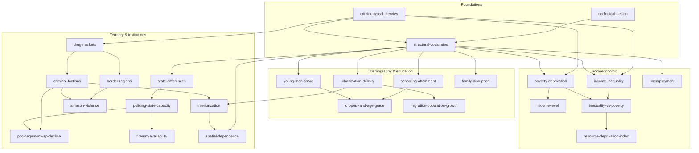

# Map: homicidios-determinantes

Subfields:
- (A) Foundations of ecological homicide research
- (B) Socioeconomic factors
- (C) Demography and education
- (D) Territory and institutions

## Concepts

Rows are in teaching order. Prerequisites are concept ids, comma-separated, or `-`.
Status is one of: unseen, introduced, practised, recalled-later, can-explain.

| id | concept | prerequisites | status |
|---|---|---|---|
| ecological-design | Ecological (macro-level) homicide studies: the territory as the unit, rates per 100k, and the ecological fallacy | - | unseen |
| criminological-theories | Macro theories: social disorganization, strain/relative deprivation, routine activities, institutional anomie | - | unseen |
| structural-covariates | The standard set of structural covariates and its instability across studies (Land, McCall & Cohen 1990; the McCall et al. replications) | ecological-design, criminological-theories | unseen |
| income-inequality | Income inequality (Gini and similar) and homicide: cross-national and Brazilian evidence | criminological-theories, structural-covariates | unseen |
| poverty-deprivation | Absolute poverty and deprivation and homicide | criminological-theories, structural-covariates | unseen |
| income-level | Average income level and homicide: linear, or nonlinear (an inverted U?) | poverty-deprivation | unseen |
| inequality-vs-poverty | Inequality versus poverty: which one predicts homicide once both are controlled | income-inequality, poverty-deprivation | unseen |
| unemployment | Unemployment and labour-market conditions and homicide (an ambiguous sign?) | structural-covariates | unseen |
| resource-deprivation-index | Composite deprivation indices built to handle collinearity among socioeconomic covariates | inequality-vs-poverty | unseen |
| young-men-share | The share of young men (15–29) and the age structure: the demographic explanation of Brazil's homicide trends (Mello & Schneider; Cerqueira?) | structural-covariates | unseen |
| schooling-attainment | Schooling, school attendance and homicide (education as protection) | structural-covariates | unseen |
| dropout-and-age-grade | School dropout, age-grade distortion and youth involvement in violence | schooling-attainment, young-men-share | unseen |
| family-disruption | Family disruption (female-headed households, divorce) as a structural covariate | structural-covariates | unseen |
| urbanization-density | Urbanization, population size and density and homicide | structural-covariates | unseen |
| migration-population-growth | Migration and fast population growth (frontier towns, mega-projects) and homicide | urbanization-density | unseen |
| drug-markets | Drug markets and trafficking routes as drivers of lethal violence | criminological-theories | unseen |
| criminal-factions | Criminal factions in Brazil (PCC, CV, regional factions), their wars and their expansion after 2016 | drug-markets | unseen |
| interiorization | The interiorization of violence: the shift of homicides from capitals and metro areas to medium-sized interior cities | criminal-factions, urbanization-density | unseen |
| border-regions | Border regions and trafficking corridors (the faixa de fronteira) | drug-markets | unseen |
| amazon-violence | Violence in the Amazon: land conflict, deforestation, illegal mining and faction routes | border-regions, criminal-factions | unseen |
| state-differences | Large differences in homicide rates between Brazilian states and their institutional sources | structural-covariates | unseen |
| policing-state-capacity | Policing, the justice system, incarceration and state capacity as explanations | state-differences | unseen |
| pcc-hegemony-sp-decline | The São Paulo homicide decline: policing and Estatuto do Desarmamento versus PCC hegemony versus demography | criminal-factions, policing-state-capacity | unseen |
| firearm-availability | Firearm availability and the Estatuto do Desarmamento (2003) | policing-state-capacity | unseen |
| spatial-dependence | Spatial clustering of homicide and spatial diffusion across neighbouring municipalities | structural-covariates, interiorization | unseen |

## Open questions and debates

- **Inequality or poverty?** Fajnzylber, Lederman & Loayza (2002) find inequality robust cross-nationally. Some US county work finds poverty or deprivation dominates once both are controlled (Pridemore 2008?). How the Brazilian municipal evidence comes out is unclear: does the Gini survive controls such as region or state fixed effects?
- **Why did São Paulo's homicides fall in the 2000s?** Three accounts compete: better policing and disarmament (Cerqueira? Kahn?), PCC hegemony and the "pacification" of crime markets (Feltran, Biderman et al.?), and demographic ageing (Mello & Schneider?).
- **What drove the post-2016 surge in the North and Northeast?** The faction war between PCC and CV and their allies, versus socioeconomic drivers. How much state fixed effects absorb is a methodological question with substantive meaning.
- **Does education protect?** The causal evidence (e.g. Cerqueira? on schooling and homicide; compulsory-schooling studies?) is weaker than the cross-sectional correlations.
- **Unemployment's sign:** motivation pushes it positive, guardianship and routine activities push it negative, and studies get either sign (Cantor & Land?).
- **Is income's effect nonlinear?** Middle-income municipalities may have the highest rates (an inverted U?). It is unclear whether the literature reports this.
- **Ecological inference limits:** municipal-level associations cannot be read as individual risk.
